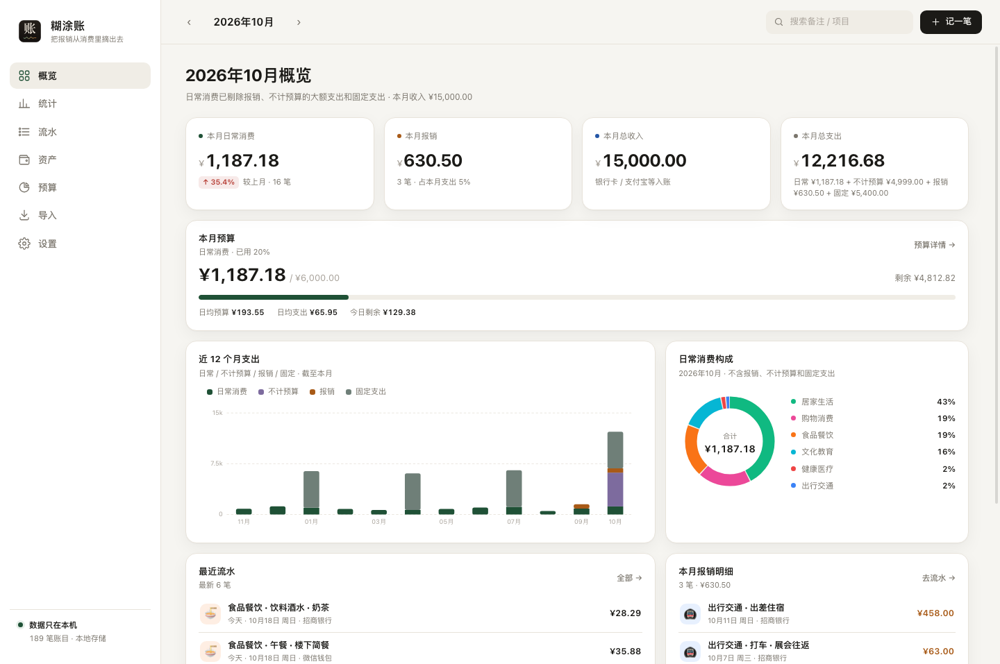
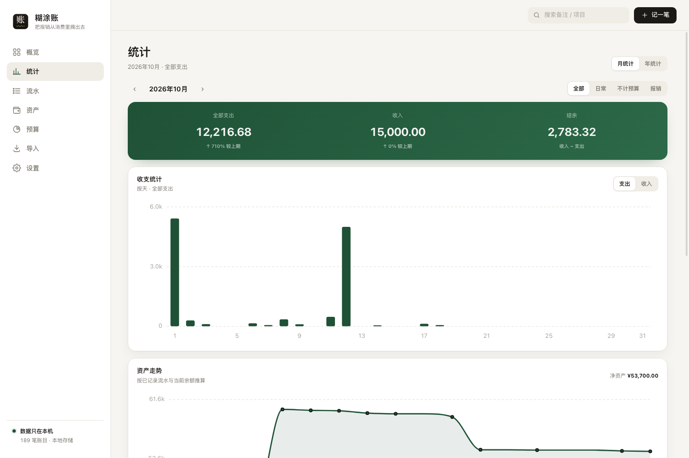
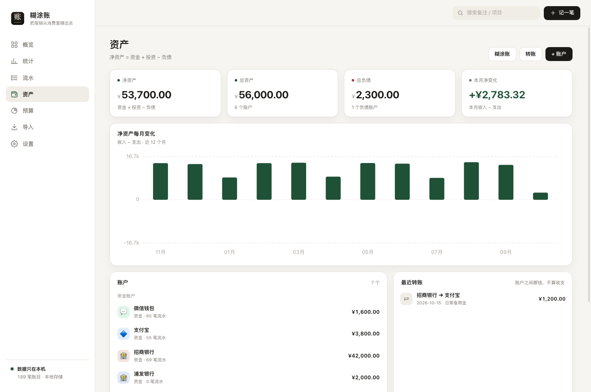
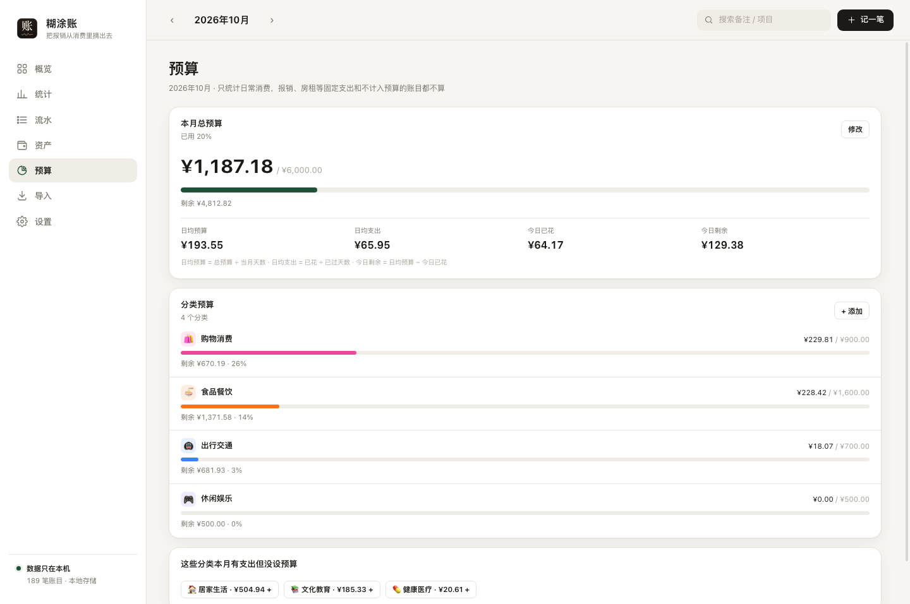

<div align="center">


# 糊涂账

一个本地记账小工具，只解决一件事：**把报销的账目从日常消费里摘出去**。

<p>
  
  
  
</p>

[功能](#功能) · [下载 / 运行](#下载--运行) · [演示数据](#演示数据) · [打包](#打包)

</div>

<p align="center">
  
</p>

> 截图使用合成数据，不包含任何真实账目；生成方式见 [演示数据](#演示数据)。

记账时把每笔支出标成「日常」或「报销」。报销的账目照常留在流水里，但**不进入日常消费统计**：

```
日常消费 = 全部支出 − 报销 − 固定支出 − 不计预算
```

不跟踪提交、不跟踪到账。公司报销经常夹带餐补，回款金额和支出本来就不一致，去对账只会添乱。

## 功能

- **记一笔**：金额、分类（两级）、账户、时间、备注；一键切换「日常 / 报销」；选到差旅类分类会自动切到报销
- **自动标报销**：高铁 / 飞机 / 酒店 / 打车默认标为报销，关键词可在设置里增删
- **流水**：按天分组、可按具体日期跳转、按日常/报销/分类/账户筛选、关键词搜索（跨月）、批量标记、批量删除；筛选后可一键清除；支持连续流水瀑布加载，按月份和日期分段；可批量标为「不计预算」
- **概览**：本月日常消费（环比）、本月报销、本月收入、本月总支出；本月预算进度（日均预算 / 今日剩余）；12 个月趋势（日常 / 不计预算 / 报销 / 固定，固定截至本月，不随上方月份切换）、分类占比、本月报销明细
- **图表交互**：柱状图、环形图、净资产曲线都可以悬浮查看具体金额
- **统计**：月统计 / 年统计；收支统计（按天/按月）、收支占比、资产走势；概览卡片可点击跳转
- **资产 / 净资产**：银行卡、支付宝、微信、投资、信用卡统一管理；净资产 = 资金 + 投资 − 负债；支持转账、糊涂账
- **预算**：总预算 + 分类预算 + 日均预算，按自然月统计日常消费，报销账目自动不计入
- **固定支出**：房租、学费这类大额支出可以标记「不计入日常消费」，仍计入总支出和净资产
- **导入**：支付宝、微信支付账单、第三方记账 App 导出（`.xlsx` / `.csv`），按行去重，可重复导入；也支持恢复 `.db` 数据库备份
- **导出**：CSV 可选全部 / 今年 / 本月，带 BOM，Excel 直接打开；可一键备份整个数据库
- **规则可编辑**：报销关键词 / 排除词、固定支出关键词都能在设置里增删，支持恢复默认
- **完全离线**：只监听 `127.0.0.1`，不联网、不上传、无遥测

## 下载 / 运行

仓库不提交打包产物。到 **GitHub Releases** 下载：

```
hutuzhang-1.0.0-macos-arm64.zip
```

解压后双击 `糊涂账.app`。首次打开若提示“无法验证开发者”，右键 → 打开，或：

```bash
xattr -dr com.apple.quarantine "糊涂账.app"
```

### 从源码运行

要求：macOS、Python 3.9+。

```bash
git clone <你的仓库地址>
cd hutuzhang

python3 -m venv .venv
.venv/bin/pip install -r requirements.txt

# 原生窗口
.venv/bin/python run.py

# 或只跑 API，浏览器打开 http://127.0.0.1:8000
.venv/bin/python -m uvicorn app.main:app --port 8000
```

## 数据与备份

数据保存在：

```
~/Library/Application Support/hutuzhang/hutuzhang.db
```

首次启动新版本时，如果这个路径还没有数据库，会自动从旧路径
`~/Library/Application Support/JingZhi/jingzhi.db` 复制一份过来，旧文件保留不删。

备份 = 复制这个文件。迁移电脑也只需要它。

数据目录可用 `HUTUZHANG_HOME` 覆盖，端口可用 `HUTUZHANG_PORT` 固定；旧 `JINGZHI_HOME` / `JINGZHI_PORT` 仍兼容。

## 导出与备份

设置 → 数据：

- **导出 CSV**：范围选全部 / 今年 / 本月；导出到 `~/Downloads`，完成后显示完整路径，可一键打开所在文件夹
- 字段：日期、时间、收支、金额、分类、账户、用途、标记、项目、备注、三个排除标记、来源
- CSV 只含账目明细，**不含转账和预算**；需要完整备份时点「备份数据库」
- **备份数据库**：用 SQLite 在线备份生成一个 `.db` 文件，账户、转账、预算、设置全在里面
- **恢复备份**：导入页拖入 `.db` → 预览账目 / 账户 / 转账 / 预算 → 恢复；恢复前会自动再备份一次当前数据库

## 从支付宝导入

1. 支付宝 → 我的 → 账单 → 右上角 → 开具交易流水证明 / 导出交易明细
2. 会得到一个 zip，解压出 `支付宝交易明细(YYYYMMDD-YYYYMMDD).csv`
3. 糊涂账 → 导入 → 拖入 csv（或点“本机找到的导出文件”）

会自动完成：

- 识别 UTF-8 / GBK 编码和文件头部的说明行
- `收/支` 决定支出/收入，`交易状态` 为「已关闭 / 等待付款」的自动跳过，「等待确认收货」照常导入
- `交易分类` 映射到糊涂账分类，并用商户/商品关键词纠偏（比如美团外卖归到食品餐饮、美团单车归到出行交通）
- `收/付款方式` 映射到账户：账户余额 → 支付宝，`招商银行储蓄卡(****)` → 招商银行，花呗单独成账户
- 备注 = 交易对方 · 商品说明，自动去掉长订单号
- 同一文件重复导入不会产生重复记录

> ⚠️ 同一时间段不要同时导入支付宝账单和其他记账 App 的账单：两边都记了同一笔消费，会重复统计。建议只保留一边。

## 从微信支付导入

1. 微信 → 我 → 服务 → 钱包 → 账单 → 常见问题 → 下载账单 → 用于个人对账
2. 解压得到 `微信支付账单流水文件(YYYYMMDD-YYYYMMDD)_*.csv`（有些版本是 xlsx）
3. 糊涂账 → 导入 → 拖入文件

会自动完成：

- 读取 `交易时间 / 收/支 / 金额(元) / 支付方式 / 当前状态`
- `支付失败 / 已撤销 / 已关闭` 自动跳过；`已转账 / 已收钱 / 已存入零钱 / 退款` 正常导入
- 支付方式映射账户：`零钱 / 零钱通` → 微信钱包，`招商银行储蓄卡(****)` → 招商银行，亲属卡、分付单独成账户
- 微信没有消费分类，按「交易对方 + 商品 + 交易类型」关键词映射：美团 → 食品餐饮，滴滴 → 出行交通，京东 → 购物消费，药房 → 健康医疗……
- 交易单号做去重键；老版本没有单号时用「时间 + 金额 + 对方 + 商品」兜底
- `不计收支` 的充值 / 提现 / 还款会导入，但标记为「不计入收支」，不进日常消费和预算

## 从其他记账 App 迁移

1. 在原 App 里导出账单（`.xlsx` 或 `.csv`）
2. 糊涂账 → 导入 → 拖入文件（或点“本机找到的导出文件”直接预览）
3. 预览确认笔数 / 金额 / 时间范围 → 合并导入
4. 流水里把该报销的账目勾上 → 「标为报销」

> 不同 App 的导出字段不同，能否识别取决于实际格式；本项目与这些 App 没有关联或背书关系。导入只解析你自己导出的文件，不会读取 App 内部数据。

## 自动标报销的规则

以下支出默认标为**报销**（不计入日常消费）：

| 规则 | 关键词 |
|---|---|
| 高铁 / 火车 | 高铁、动车、火车、铁路、12306 |
| 飞机 | 机票、飞机、航班、航空 |
| 酒店 / 住宿 | 酒店、宾馆、住宿、民宿、客栈、旅馆、青旅 |
| 打车 | 打车、滴滴、出租车、网约车、花小猪、曹操出行、T3 出行、高德打车… |

- **导入时**自动应用，预览里会显示「默认标为报销 N 笔」
- **手动记账**时选到「出行交通 · 火车 / 飞机 / 打车」会自动切到报销，也可以手动改回日常
- **已有账目**：设置 → 「应用到全部历史账目」；规则修改默认只影响新账目，点这个按钮才会统一历史（先算数量再确认）
- 地铁、公交、轨道交通不算，避免「某某地铁（某某火车站）」这类地名误判

> 默认规则只是省事，不是绝对判断：私人行程的高铁、酒店也会被标成报销，流水里点开改回日常即可。

## 糊涂账

流水对不上、又不想逐笔排查的时候用：

1. 资产页右上角 → **糊涂账**
2. 按实际情况填每个账户现在有多少钱（信用卡填欠款）
3. 右边会实时显示「补 +¥x / 冲 −¥x」
4. 可以写一句说明（例如「8 月有几天没记账」）
5. 点「生成调整记录」

点「糊涂账」后，会为每个有差额的账户生成一笔 **糊涂账调整**：

- 记在流水里，带「糊涂账」标签，备注写明 `原余额 → 实际余额（补记/冲减）`
- 只影响账户余额和净资产
- **不计入收支统计、日常消费、预算**（`exclude_stats / exclude_daily / exclude_budget` 全开）
- 信用卡等负债账户按欠款方向自动处理

> 它是「补丁」，不是「修复」。如果之后找到了漏记的账，记得把对应的糊涂账调整删掉或改小，否则会重复计算。

## 统计



- **月统计 / 年统计**：月视图按天出柱状图，年视图按月出柱状图
- **收支统计**：支出 / 收入切换，柱状图上可以直接看每天（每月）的金额
- **收支占比**：支出 / 收入切换；支出按一级分类，收入按工资、奖金等子分类，环形图 + 明细（金额、笔数、百分比）
- **资产走势**：月视图按天、年视图按月画净资产曲线（净值 = 资金 + 投资 − 负债），悬浮显示某天/某月的具体净值
- **口径切换**：默认「全部」，可切日常 / 不计预算 / 报销；日常和不计预算互斥，报销口径下不统计收入
- **概览跳转**：点概览的「本月日常消费 / 本月报销 / 总收入 / 总支出」进入对应统计，点趋势图进年统计，点分类环形图进占比

> 资产走势是按「当前余额 + 已记录流水」反推的，曲线是否准确取决于流水是否完整、当前余额是否校准。它不是历史快照，只是估计。

## 规则

设置 → **报销规则** / **固定支出**：

- 报销：关键词、排除词，都可以点 `×` 删除或输入新增
- 固定支出：关键词，同样可编辑
- 分类名称本身也会参与关键词匹配：比如分类「火车」「房租」，关键词里有「火车」「房租」就能命中
- 改完立即生效，导入和手动记账都会用新规则
- 修改规则默认只影响之后的新账目；要统一历史数据，用页面底部的「应用到全部历史账目」
- 可以「恢复默认」
- 规则存在数据库的 `settings` 表里，备份数据库时会一起带走

## 房租和固定支出

房租三个月交一次，直接和吃饭打车放在一起会把当月日常消费拉爆。糊涂账给这类支出一个独立标记：

- 记一笔时在「更多选项」里勾 **不计入日常消费**；选到「居家生活 · 房租」会自动勾上
- 仍计入**总支出**和**净资产**，但不进日常消费、不进统计的「日常」口径、不占预算
- 导入支付宝 / 微信 / 其他 App 账单时，分类是房租或备注含「房租 / 租金 / 租房」会自动标记
- 之前的房租账目：把规则加到「固定支出」关键词里，再点页面底部的「应用到全部历史账目」

> 这是「排除」，不是「摊销」。如果你更希望把 3 个月房租平摊到每个月（每月只算 1/3），那是另一套预付款逻辑，可以后面再加。

## 资产与净资产



- 账户分三类：**资金账户**（银行卡 / 支付宝 / 微信 / 现金）、**投资**、**负债**（信用卡 / 借款）
- 余额是实时算的：`当前余额 = 期初 + 收入 − 支出 + 转入 − 转出`，不需要手动更新
- 新增或编辑账户时填**当前实际余额**，糊涂账会反推期初；信用卡填当前欠款即可
- **转账**只挪账户余额，不算支出也不算收入（还信用卡就用这个）
- 资产页「净资产每月变化」的柱子可以点，直接跳到对应月份的统计
- 净资产 = 资金 + 投资 − 负债；「本月净变化」= 本月收入 − 支出

> 资产页展示的是每月**净变化**（收入 − 支出），不是历史净资产曲线。历史某天你到底有多少钱，只靠流水和当前余额是推不准的；如果你需要精确的历史净资产，可以后续加「月末快照」。

## 预算



- 可以设一个**总预算**，再给一级分类分别设预算
- 总预算下会算出 **日均预算 = 总预算 ÷ 当月天数**
- 当前月显示：日均预算 / 日均支出 / 今日已花 / 今日剩余；过去月份显示日均预算和日均支出
- 日均支出 = 已花 ÷ 已过天数；今日剩余 = 日均预算 − 今日已花
- 只统计 `日常`、没勾「不计入预算」、也没标记「不计入日常」的支出：报销和房租等固定支出都不占预算
- 总预算包含未分类支出；分类预算按一级分类汇总（子分类的支出算进父分类）
- 预算按自然月重置，设置一次每月沿用；超支会变红
- 手机、电脑这类不频繁的大额支出，可以在流水里多选后标为「不计预算」：不进日常消费统计、不占月度预算，但仍计入总支出和净资产；统计页可以单独看「不计预算」，再点一次可恢复「计入预算」

## 开发

```bash
python3 -m venv .venv
.venv/bin/pip install -r requirements.txt

# 开发模式（本地服务 + 原生窗口）
.venv/bin/python run.py

# 只跑 API（浏览器访问 http://127.0.0.1:8000）
.venv/bin/python -m uvicorn app.main:app --port 8000
```

数据目录可用 `HUTUZHANG_HOME` 覆盖（旧 `JINGZHI_HOME` 仍兼容），端口可用 `HUTUZHANG_PORT` 固定。

## 演示数据

README 截图来自一套合成数据，可以本地复现：

```bash
# 终端 1：用一个临时数据目录启动
HUTUZHANG_HOME=/tmp/hutuzhang-demo \
  .venv/bin/python -m uvicorn app.main:app --port 8799

# 终端 2：写入 12 个月假账、预算、转账和账户余额
BASE=http://127.0.0.1:8799 .venv/bin/python tools/seed_demo.py
```

浏览器打开 `http://127.0.0.1:8799` 即可。脚本只调用本地 API，所有名字和金额都是虚构的。

## 项目结构

```text
app/
  api.py          HTTP API
  db.py           SQLite schema / 迁移
  importer.py     支付宝、微信、第三方记账导出
  rules.py        报销 / 固定支出规则
  static/         原生前端
tools/
  seed_demo.py    生成演示数据
  make_icon.py    生成 App 图标
tests/
  smoke.py        端到端 API 测试
assets/           图标和截图
```

## 测试

```bash
.venv/bin/python tests/smoke.py     # 172 项 API 端到端断言，使用临时数据目录
```

## 说明

- 仅支持 macOS（Apple Silicon）
- 没有云同步、账号体系或遥测
- 所有金额以整数分存储，避免浮点误差
- 报销只做「标记」，不跟踪提交、审批、到账


## 打包

```bash
./package.sh
```

产物：

- `dist/糊涂账.app`（arm64，约 41 MB）
- `hutuzhang-1.0.0-macos-arm64.zip`（约 17 MB）

构建脚本会设置 `PYINSTALLER_CONFIG_DIR`，避免写入系统缓存目录；打包后统一写入 1.0.0 版本并做 ad-hoc 签名。

## 技术栈

- 后端：FastAPI + SQLite（标准库 `sqlite3`），金额以「分」存储
- 前端：原生 HTML/CSS/JS，无构建步骤；图表为手写 SVG
- 外壳：pywebview（WKWebView）+ 本地 uvicorn
- 打包：PyInstaller

## 数据表

| 表 | 说明 |
|---|---|
| `entries` | 账目：`kind`(支出/收入)、`usage`(personal/work)、`exclude_stats` |
| `categories` | 两级分类，`parent_id` 为空即一级 |
| `accounts` | 账户：`type`(asset/investment/liability)、`opening_cents` 期初 |
| `transfers` | 账户间转账 |
| `budgets` | 预算：`category_id` 为空表示总预算 |
| `settings` | 预留键值 |

金额字段一律为整数分（`amount_cents`），避免浮点误差。

## 口径说明

- 「日常消费」只统计 `usage=personal` 的支出，且排除 `exclude_stats=1` 和 `exclude_daily=1`（房租等固定支出）
- 「报销」是 `usage=work` 的支出：仍出现在流水和「本月总支出」里，但不进日常消费
- 报销没有状态流转，也没有提交/到账记录：标记一次，永久排除在日常消费之外

## License

MIT

## 第三方名称

支付宝、微信支付等名称和商标归各自所有者。本项目是独立的本地工具，与这些产品没有关联、合作或背书关系；文中提及仅用于说明数据导入/导出兼容性。
